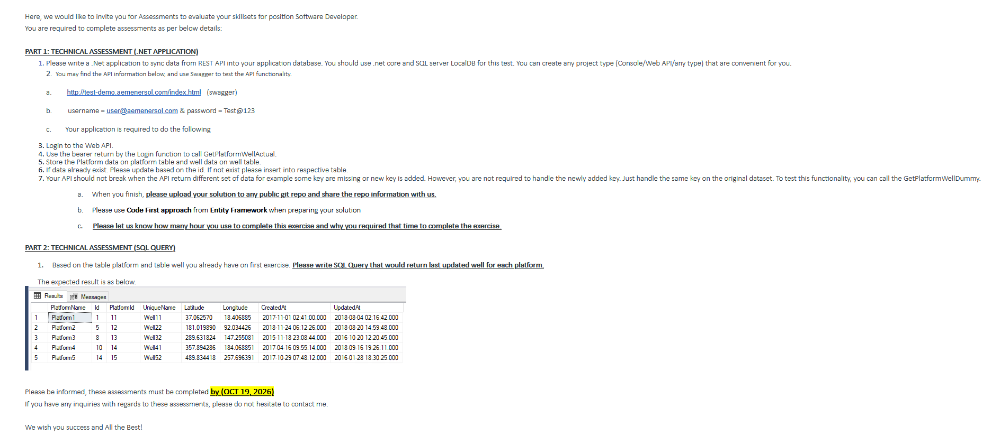

# AemenersolAssessment — .NET Technical Assessment

A .NET 8 console app that logs into the provided Web API, pulls platform/well data,
and **upserts** it into a SQL Server LocalDB database using **EF Core (Code First)**.
It also answers the Part 2 SQL question.



---

## Quick start (Windows / PowerShell)

**Needs:** .NET 8 SDK (`dotnet --list-sdks`) and SQL Server LocalDB (`sqllocaldb info` → `MSSQLLocalDB`).

```powershell
cd AemenersolAssessment
dotnet run
```

First run creates the `PlatformWellDb` database, logs in, syncs the data, and prints
the Part 2 result:

```
Final state: 10 platforms, 15 wells.

PlatformName | WellId | PlatformId | UniqueName | Latitude  | Longitude  | CreatedAt           | UpdatedAt
Platform1    | 1      | 11         | Well11     | 37.06257  | 18.406885  | 2017-11-01 02:41:00 | 2018-08-04 02:16:42
Platform2    | 5      | 12         | Well22     | 181.01989 | 92.034426  | 2018-11-24 06:12:26 | 2018-08-20 14:59:48
Platform3    | 8      | 13         | Well32     | 289.631824| 147.255081 | 2015-11-18 23:08:44 | 2016-10-20 12:20:45
Platform4    | 10     | 14         | Well41     | 357.894286| 184.068851 | 2017-04-16 09:55:14 | 2018-09-16 19:26:11
Platform5    | 14     | 15         | Well52     | 489.834418| 257.696391 | 2017-10-29 07:48:12 | 2016-01-28 18:30:25
```

Run it a second time — still **10 platforms, 15 wells**, no duplicates. That's the upsert.

---

# PART 1 — TECHNICAL ASSESSMENT (.NET APPLICATION)

## What it does

1. `POST /api/Account/Login` → JWT token (`ApiClient.LoginAsync`)
2. Attach token as `Authorization: Bearer …`
3. `GET /api/PlatformWell/GetPlatformWellActual` → platforms with nested wells
4. Upsert into `platform` and `well` tables
5. Re-sync from `GetPlatformWellDummy` to prove tolerance of a different payload shape

## Requirement → implementation

| # | Requirement | File |
|---|-------------|------|
| 3 | Login to the Web API | `Services/ApiClient.cs` |
| 4 | Use bearer token to call `GetPlatformWellActual` | `Services/ApiClient.cs`, `Program.cs` |
| 5 | Store platform / well data | `Models/Platform.cs`, `Models/Well.cs` |
| 6 | Upsert by `id` | `Services/DataSyncService.cs` |
| 7 | Don't break on missing / extra keys | `Models/Dtos.cs`, `Services/DataSyncService.cs` |
| 7a | Solution in a public git repo | this repository |
| 7b | EF Core Code First | `Data/AppDbContext.cs`, `Migrations/` |
| 7c | Hours spent and why | [`TIME_SPENT.md`](TIME_SPENT.md) |

## Key decisions

- **Upsert by id** — each record is looked up by `id`; update if found, insert if not.
  Second run changes nothing, so no duplicates.
- **`ValueGeneratedNever()` on `Id`** — ids come from the API. EF would otherwise make
  them identity columns, and SQL Server rejects inserting explicit values into them.
- **Code First** — entities define the schema; `dotnet ef migrations add` generated the
  migration for `platform` / `well`.
- **Singular table names** — EF would pluralise; we force `platform` and `well` to match
  the assessment and the Part 2 query.

## Requirement 7 — missing / extra keys

The two endpoints return different shapes: `Actual` has `createdAt`/`updatedAt`, `Dummy`
has `lastUpdate` and no `createdAt`. The sync doesn't break because:

- DTO date fields are **nullable** → a missing key becomes `null`, not an exception.
- `System.Text.Json` **ignores unknown properties by default** → a new key is skipped.
- `UpdatedAt = dto.UpdatedAt ?? dto.LastUpdate ?? existing` → keeps working with either
  payload, and never wipes a value that wasn't sent.

---

# PART 2 — TECHNICAL ASSESSMENT (SQL QUERY)

**Task:** return the last updated well for each platform.

File: [`Queries/LastUpdatedWellPerPlatform.sql`](AemenersolAssessment/Queries/LastUpdatedWellPerPlatform.sql)

```sql
SELECT p.UniqueName AS PlatformName, w.Id, w.PlatformId, w.UniqueName,
       w.Latitude, w.Longitude, w.CreatedAt, w.UpdatedAt
FROM platform p
INNER JOIN well w ON w.PlatformId = p.Id
WHERE w.Id = (
    SELECT TOP 1 w2.Id
    FROM well w2
    WHERE w2.PlatformId = p.Id
    ORDER BY w2.UpdatedAt DESC, w2.Id DESC
)
ORDER BY p.UniqueName;
```

The correlated subquery selects, per platform, the well with the greatest `UpdatedAt`.
`Id DESC` breaks ties so a platform never returns two rows. An equivalent `ROW_NUMBER()
OVER (PARTITION BY …)` version is in the same file.

Run it in SSMS, or:

```powershell
sqlcmd -S "(localdb)\mssqllocaldb" -d PlatformWellDb -i AemenersolAssessment\Queries\LastUpdatedWellPerPlatform.sql
```

**Expected result** (matches the assessment):

```
PlatformName | Id | PlatformId | UniqueName | Latitude  | Longitude  | CreatedAt           | UpdatedAt
Platform1    | 1  | 11         | Well11     | 37.06257  | 18.406885  | 2017-11-01 02:41:00 | 2018-08-04 02:16:42
Platform2    | 5  | 12         | Well22     | 181.01989 | 92.034426  | 2018-11-24 06:12:26 | 2018-08-20 14:59:48
Platform3    | 8  | 13         | Well32     | 289.631824| 147.255081 | 2015-11-18 23:08:44 | 2016-10-20 12:20:45
Platform4    | 10 | 14         | Well41     | 357.894286| 184.068851 | 2017-04-16 09:55:14 | 2018-09-16 19:26:11
Platform5    | 14 | 15         | Well52     | 489.834418| 257.696391 | 2017-10-29 07:48:12 | 2016-01-28 18:30:25
```

---

## Configuration

| Variable | Default | Purpose |
|----------|---------|---------|
| `DB_PROVIDER` | `SqlServer` | `SqlServer` or `Sqlite` |
| `CONNECTION_STRING` | `Server=(localdb)\mssqllocaldb;Database=PlatformWellDb;Trusted_Connection=True;TrustServerCertificate=True;` | DB connection |

**No LocalDB?** Use SQLite (schema via `EnsureCreated` instead of migrations, same behaviour):

```powershell
$env:DB_PROVIDER="Sqlite"; $env:CONNECTION_STRING="Data Source=platformwell.db"; dotnet run
```

**Full SQL Server (Docker):**

```bash
docker run -d --name mssql -e ACCEPT_EULA=Y -e MSSQL_SA_PASSWORD=Your_password123 \
  -e MSSQL_PID=Developer -p 1433:1433 mcr.microsoft.com/mssql/server:2022-latest
CONNECTION_STRING="Server=localhost,1433;Database=PlatformWellDb;User Id=sa;Password=Your_password123;TrustServerCertificate=True;" dotnet run
```

## Project layout

```
AemenersolAssessment/
├── Program.cs                          # flow: DB setup → login → sync → print result
├── Services/ApiClient.cs               # login + bearer token + HTTP calls
├── Services/DataSyncService.cs         # upsert logic
├── Data/AppDbContext.cs                # EF Core config (provider, tables, keys, FK)
├── Models/Platform.cs, Well.cs         # entities
├── Models/Dtos.cs                      # API payload shapes
├── Migrations/                         # Code First migration
└── Queries/LastUpdatedWellPerPlatform.sql   # Part 2
```

## Troubleshooting

| Symptom | Fix |
|---------|-----|
| `No .NET SDKs were found` | Install .NET 8 SDK, open a new terminal |
| `Unable to locate a Local Database Runtime` | Install SQL Server LocalDB, or use the SQLite command above |
| Login/sync errors | Check internet access to `test-demo.aemenersol.com` |

## 7c — Time spent

~5 hours — see [`TIME_SPENT.md`](TIME_SPENT.md) for the breakdown and reasoning.
